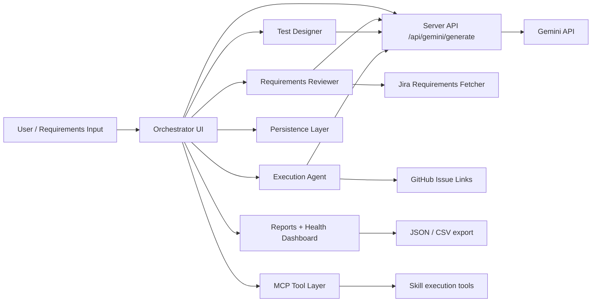

# QA Nexus Autonomous Agent

> Project identity and engineering guidance for the QA Nexus Autonomous repository.

## 1. Purpose

QA Nexus Autonomous is a high-fidelity, multi-agent QA orchestration application built with React, TypeScript, and Google Gemini 2.5. It helps teams turn loose requirements into structured specification review, traceable test design, execution analysis, and reporting dashboards.

This repository is designed to be both:
- a usable product for QA workflows, and
- a clear reference implementation for agentic, tool-using AI application patterns.

## 2. Current project state

- Version: 3.3.0
- Node: >= 24.0.0
- Package manager: npm
- Runtime: Vite + React 19 + TypeScript 6
- AI provider: Google Gemini 2.5 via `@google/genai` (Server-side API Endpoint)
- Test framework: Vitest + Testing Library
- Linting: ESLint 10 flat config

## 3. Architecture overview



### Core responsibilities

- Orchestrator UI: central workflow state and navigation across tabs.
- Requirements Reviewer: ambiguity detection, risk scoring, completeness checks.
- Test Designer: traceable scenarios and acceptance criteria mapping.
- Execution Agent: simulate run outcomes and track test execution status.
- Server API Endpoint (`/api/gemini/generate`): secure backend boundary handling Gemini API calls using server-side `GEMINI_API_KEY` with rate limiting, model restriction, payload limits, and error sanitization.
- Reports & Health Dashboard: summarize metrics, coverage, latency, tool usage, and system health.
- Persistence layer: session restoration, local state recovery, and application memory.
- MCP / Skills: structured tool execution and reusable AI capabilities.

## 4. Repository layout

```text
.
├── .github/
├── docs/
├── public/
├── scripts/
├── skills/
├── src/
│   ├── assets/
│   ├── components/
│   ├── hooks/
│   ├── server/
│   ├── services/
│   ├── tests/
│   ├── types/
│   ├── utils/
│   ├── App.tsx
│   ├── main.tsx
│   └── ...
├── supabase/
├── .env.example
├── .nvmrc
├── AGENT.md
├── CHANGELOG.md
├── CONTRIBUTING.md
├── eslint.config.js
├── index.html
├── LICENSE
├── package.json
├── README.md
├── skills.md
├── tsconfig.json
├── tsconfig.node.json
├── vite.config.ts
├── vitest.config.ts
├── package-lock.json
└── .gitignore
```

## 5. Setup and development

### Install

```bash
npm install
```

### Environment variables

Copy the sample environment file before running the app:

```bash
cp .env.example .env
```

Required and optional values:

```dotenv
# Server-side ONLY (Required)
GEMINI_API_KEY=your_gemini_api_key_here

# Client-side (Optional)
VITE_SUPABASE_URL=your_supabase_url_here
VITE_SUPABASE_ANON_KEY=your_supabase_anon_key_here
```

Rules:
- `GEMINI_API_KEY` is required on the server for AI workflows.
- Never prefix private secrets with `VITE_`.
- Supabase values are optional and only needed for persistence features.
- Never commit real secrets.

### Run the app

```bash
npm run dev
```

### Production build

```bash
npm run build
```

### Quality gates

```bash
npm run validate-filenames
npm run lint
npm run typecheck
npm test
npm run check-secrets
npm run ci
```

`npm run ci` is the canonical repository validation command and should be used before finalizing changes.

## 6. Key technical patterns

### React + TypeScript

- Use TypeScript strict typing and avoid `any` unless explicitly unavoidable.
- Prefer interfaces/types in `src/types/`.
- Use the `@/` import alias for project-local imports.
- Keep UI components focused and composable.

### Service layer organization

The project is structured around a service-oriented architecture:
- AI orchestration and prompts live in service modules.
- Server API proxy keeps Gemini keys off the browser client.
- Persistence concerns are separated from UI logic.
- Tools and integrations are isolated behind small interfaces.
- The orchestrator coordinates state transitions rather than embedding business logic in components.

### Logger and diagnostics

- Prefer the centralized logger over raw `console.*` calls.
- Use debug-level logging sparingly and only where it aids diagnosis.
- Keep warnings and errors actionable and useful to developers.

### Testing expectations

- Add or update tests with functional changes.
- Keep tests close to the feature area under `src/tests/`.
- Prefer Testing Library for UI-level validation.
- Use Vitest for unit and integration coverage.

---

## 14. References

- `README.md` — product overview and setup instructions
- `skills.md` — skill registry and capability definitions
- `CHANGELOG.md` — release history and current version notes
- `CONTRIBUTING.md` — repository contribution workflow

---

Last updated: October 24, 2026
Version: 3.3.0
