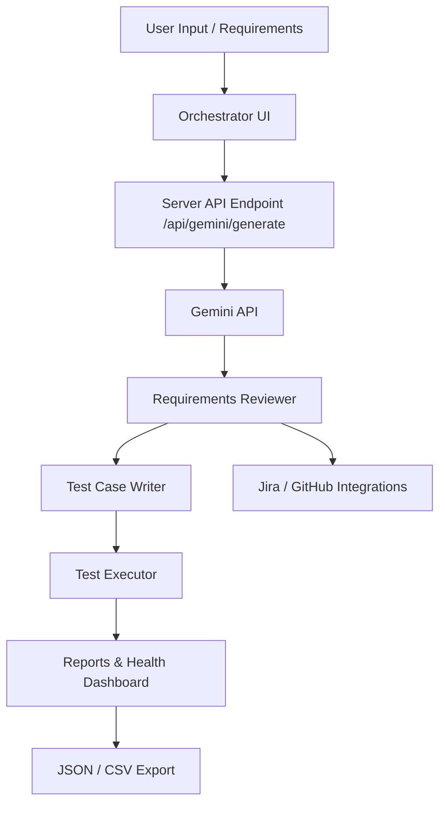

# QA Nexus Autonomous

> A high-fidelity, multi-agent AI orchestrator powered by Google Gemini 2.5 that automates the end-to-end QA lifecycle—from intelligent requirements analysis and ambiguity detection to traceable test case generation, simulated test execution, Jira requirement fetching, and GitHub issue reporting.


---

## Table of Contents

- [Overview](#overview)
- [Key Features](#key-features)
- [Architecture](#architecture)
- [Prerequisites](#prerequisites)
- [Quick Start](#quick-start)
- [Usage Workflow](#usage-workflow)
- [Technology Stack](#technology-stack)
- [Testing](#testing)
- [CI/CD Pipeline](#cicd-pipeline)
- [Project Structure](#project-structure)
- [Documentation](#documentation)
- [Contributing](#contributing)
- [License](#license)

---

## Overview

QA Nexus Autonomous is a React + TypeScript application for AI-assisted quality assurance orchestration. It brings together a set of specialized agents to analyze requirements, identify ambiguities, generate test cases, and execute them with full traceability.

The system is designed to reduce manual QA overhead while preserving traceability from requirement to test and result. All Gemini API calls are securely routed through a server-side endpoint (`/api/gemini/generate`) with rate limiting, payload validation, model restriction, and error sanitization.

### Core workflow

1. Requirements Reviewer: evaluates completeness, clarity, risk, and missing edge cases.
2. Test Case Writer: generates prioritized test scenarios with requirement traceability.
3. Test Executor: simulates execution, tracks results, and flags failures.
4. Reporting & Health Dashboard: aggregates performance, coverage, and orchestration metrics.

---

## Key Features

- Multi-agent QA orchestration powered by Google Gemini 2.5 (`gemini-2.5-pro-preview-05-06` and `gemini-2.5-flash-preview-04-17`).
- Secure server-side API boundary ensuring private Gemini API keys never enter browser bundles.
- Requirement analysis and ambiguity detection for incomplete or risky specs.
- Structured test case generation with priority levels and linked requirement IDs.
- Execution simulation with pass/fail reporting and failure reasoning.
- Real-time health dashboard for metrics, latency, and token estimation.
- Jira requirement fetching and GitHub issue reporting links.
- JSON/CSV export utilities for reports and artifacts.
- Local persistence and session state restoration via LocalStorage or Supabase.
- Modern glassmorphism UI built with React and Vite.

---

## Architecture



The app is organized around a central workflow state in `src/hooks/useWorkflow.ts`, with tabs for orchestration, agent analysis, execution, reporting, settings, and health monitoring.

---

## Prerequisites

Before running the project locally, make sure you have:

- **Node.js 24.0.0 or newer** (Node 24 LTS or later recommended)
- **npm 10 or newer**
- A Google Gemini API key from [Google AI Studio](https://aistudio.google.com)

Optional environment support:

- Supabase credentials for persistence features

### Verifying your setup

```bash
# Check Node.js version
node --version

# Check npm version
npm --version

# Both should be at or above the minimum versions
# Expected output: v24.x.x and 10.x.x respectively
```

---

## Quick Start

```bash
# Clone the repository
git clone https://github.com/darshil0/qa-nexus-autonomous.git
cd qa-nexus-autonomous

# Install dependencies
npm install

# Create your environment file
cp .env.example .env
# Add your server-side GEMINI_API_KEY to .env (and optional Supabase values if needed)

# Start the app in development mode
npm run dev
```

### Environment variables

The project separates private server-side variables from public client configuration. A sample file is provided at `.env.example`:

```dotenv
# Server-side ONLY (Required)
GEMINI_API_KEY=your_gemini_api_key_here

# Client-side (Optional)
VITE_SUPABASE_URL=your_supabase_url_here
VITE_SUPABASE_ANON_KEY=your_supabase_anon_key_here
```

**Notes:**

- `GEMINI_API_KEY` is **required** server-side for the AI workflow to run.
- `VITE_SUPABASE_*` values are optional and used by persistence-related features.
- Do not commit your real `.env` file (already configured in `.gitignore`).

---

## Usage Workflow

### Example input

Enter a requirement like:

> "Users should be able to reset their password using a magic link sent to their registered email address."

The system will:

- detect ambiguities and missing acceptance criteria,
- generate prioritized test cases,
- simulate execution outcomes,
- present metrics and traceability in the reports dashboard.

### Jira integration

Use the Orchestrator tab to fetch requirement details by Jira issue key and use that content as the workflow requirement.

### GitHub reporting

Execution results can be used to generate structured issue descriptions and links for tracking bugs on GitHub.

---

## Technology Stack

- React 19.3 — UI framework
- TypeScript 6 — type safety and application modeling
- Vite 8.3 — local dev server, build tooling, and API proxy middleware
- Vitest 4.1 — unit and UI testing
- ESLint 10 — linting and code quality
- Google Gemini 2.5 via `@google/genai` — server-side AI orchestration and reasoning
- Recharts 3.10 — reporting and analytics charts
- Lucide React — iconography

---

## Testing

Run the checks used by this repository:

```bash
# Run the test suite (single-run)
npm test

# Run the test suite in watch mode
npm run test:watch

# Run coverage reporting
npm run test:coverage

# Validate filename rules
npm run validate-filenames

# Check for secret exposure in production build
npm run check-secrets

# Type-check the app
npm run typecheck

# Lint the project
npm run lint

# Build the production bundle
npm run build

# Run full CI validation
npm run ci
```

### Local validation before PR submission

To validate your changes match the CI/CD pipeline, run:

```bash
npm run ci
```

This runs:
1. Repository filename validation (`npm run validate-filenames`)
2. Linting (`npm run lint`)
3. Type checking (`npm run typecheck`)
4. Unit tests (`npm test`)
5. Production build (`npm run build`)
6. Secret exposure check (`npm run check-secrets`)

If all steps pass, your PR is ready for submission.

---

## CI/CD Pipeline

The repository uses GitHub Actions for automated validation on every push and pull request.

### Workflow triggers

- **Push to `main` or `master` branches** — full CI validation
- **Pull requests targeting `main` or `master`** — full CI validation
- **Concurrency control** — cancels previous runs for the same branch to save resources

---

## Project Structure

```text
.
├── .github/
│   └── workflows/
│       └── ci.yml                 # GitHub Actions CI/CD pipeline
├── docs/
│   ├── ARCHITECTURE.md            # System design and component overview
│   ├── MIGRATION_GUIDE.md         # Upgrade and migration instructions
│   ├── SUPABASE_VERIFICATION.md   # Supabase RLS and database access checklist
│   └── Walkthrough.md             # Step-by-step user guide
├── public/                        # Static assets
├── scripts/
│   ├── check-secret-exposure.js   # Production bundle secret exposure check
│   └── validate-filenames.js      # Cross-platform filename validation check
├── skills/
│   ├── gemini-knowledge-base/     # AI knowledge base skill
│   ├── requirements-reviewer/     # Requirements analysis skill
│   ├── test-case-writer/          # Test generation skill
│   └── test-executor/             # Execution simulation skill
├── src/
│   ├── assets/                    # Styles and resources
│   ├── components/
│   │   ├── common/                # Reusable UI components
│   │   ├── layout/                # Layout components (Header, Sidebar, etc.)
│   │   └── tabs/                  # Tab-based UI sections
│   ├── hooks/
│   │   └── useWorkflow.ts         # Central workflow state management
│   ├── server/
│   │   └── geminiHandler.ts       # Secure Gemini API server endpoint handler
│   ├── services/
│   │   ├── agenticSkills.ts       # Agent skill orchestration
│   │   ├── geminiService.ts       # Gemini API client proxy integration
│   │   ├── mcpService.ts          # MCP tool integration
│   │   ├── memoryService.ts       # In-memory session state
│   │   └── persistenceService.ts  # Persistence integration
│   ├── tests/                     # Unit and component tests
│   ├── types/                     # TypeScript type definitions
│   ├── utils/
│   │   ├── exportUtils.ts         # JSON/CSV export utilities
│   │   ├── logger.ts              # Logging utilities
│   │   ├── sanitizeInput.ts       # Input sanitization and prompt framing
│   │   └── validateEnv.ts         # Environment variable validation
│   ├── App.tsx                    # Main app component
│   └── main.tsx                   # Application entry point
├── supabase/
│   └── migrations/                # Versioned SQL migrations for Supabase
├── .env.example                   # Environment variables template
├── .gitignore                     # Git ignore rules
├── .nvmrc                         # Node runtime baseline configuration (24)
├── AGENT.md                       # Agent architecture guide
├── CHANGELOG.md                   # Version history and release notes
├── CONTRIBUTING.md                # Contribution guidelines
├── eslint.config.js               # ESLint configuration
├── index.html                     # HTML entry point
├── LICENSE                        # MIT License
├── package.json                   # Project dependencies and scripts
├── package-lock.json              # Locked dependency versions
├── README.md                      # This file
├── skills.md                      # Skill registry and capabilities
├── tsconfig.json                  # TypeScript configuration
├── tsconfig.node.json             # TypeScript config for Node.js scripts
├── vite.config.ts                 # Vite build configuration with server plugin
└── vitest.config.ts               # Vitest test configuration
```

---

## Documentation

- [AGENT.md](AGENT.md) — agent architecture and engineering guidance
- [skills.md](skills.md) — skill registry and capabilities overview
- [docs/ARCHITECTURE.md](docs/ARCHITECTURE.md) — system design and component overview
- [docs/SUPABASE_VERIFICATION.md](docs/SUPABASE_VERIFICATION.md) — Supabase RLS and database access controls
- [docs/Walkthrough.md](docs/Walkthrough.md) — step-by-step user experience guide
- [docs/MIGRATION_GUIDE.md](docs/MIGRATION_GUIDE.md) — upgrade and migration instructions
- [CONTRIBUTING.md](CONTRIBUTING.md) — local setup and contribution workflow
- [CHANGELOG.md](CHANGELOG.md) — version history and release notes

---

## Contributing

We welcome contributions from the community. Please review [CONTRIBUTING.md](CONTRIBUTING.md) and [AGENT.md](AGENT.md) for full coding standards.

1. Fork the repository.
2. Create a feature branch: `git checkout -b feat/your-feature`.
3. Install dependencies: `npm install`.
4. Make your changes and add or update tests as needed.
5. **Before submitting a PR, validate locally:**
   ```bash
   npm run ci
   ```
6. Push to your fork and open a pull request against `main`.

---

## License

This project is licensed under the MIT License. See the [LICENSE](LICENSE) file for details.

---

**Last Updated:** October 1, 2026  
**Version:** 3.3.0
