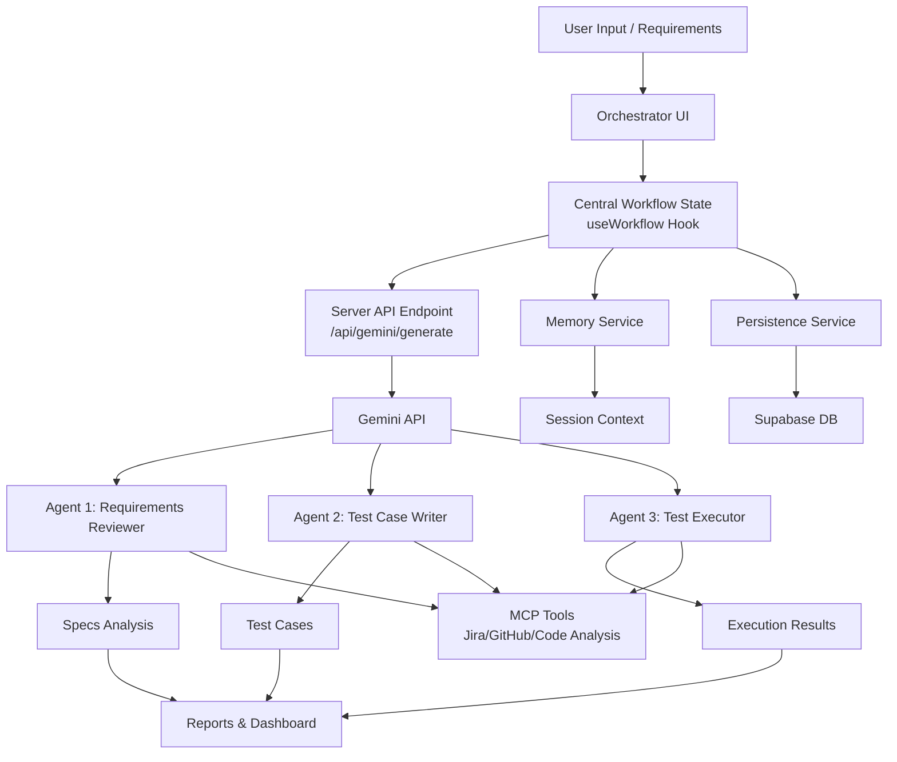

# System Architecture

**Version**: 3.3.0  
**Last Updated**: October 24, 2026

This document describes the high-level architecture, component structure, and data flow of QA Nexus Autonomous.

---

## Overview

QA Nexus Autonomous is a multi-agent AI orchestration system built with React + TypeScript. It leverages Google Gemini 2.5 (`gemini-2.5-pro-preview-05-06` and `gemini-2.5-flash-preview-04-17`) to automate the end-to-end QA lifecycle through specialized agents that:

1. **Analyze requirements** for clarity, completeness, and risks
2. **Generate test cases** with priority levels and traceability
3. **Execute tests** with realistic simulations and failure tracking
4. **Report results** with metrics and health dashboards

All Gemini API calls are securely routed through a server-side API boundary (`/api/gemini/generate`) using server-only `GEMINI_API_KEY`.

---

## Architecture Diagram



---

## Component Structure

### Top-Level Directories

```
qa-nexus-autonomous/
├── .github/workflows/           # GitHub Actions CI/CD
├── docs/                        # Documentation (this directory)
├── public/                      # Static assets
├── scripts/                     # Security & filename validation scripts
├── skills/                      # AI agent skill definitions
│   ├── requirements-reviewer/
│   ├── test-case-writer/
│   ├── test-executor/
│   └── gemini-knowledge-base/
├── src/
│   ├── components/              # React UI components
│   ├── hooks/                   # Custom React hooks
│   ├── server/                  # Server API handlers
│   ├── services/                # Business logic & APIs
│   ├── types/                   # TypeScript definitions
│   ├── utils/                   # Utility functions
│   ├── tests/                   # Unit & component tests
│   ├── assets/                  # Styles & resources
│   ├── App.tsx                  # Main app component
│   └── main.tsx                 # Entry point
├── supabase/                    # Database migrations & RLS policies
├── package.json                 # Dependencies & scripts
├── tsconfig.json                # TypeScript config
├── vite.config.ts               # Build config & server plugin
├── vitest.config.ts             # Test config
├── eslint.config.js             # Linting rules
└── README.md                    # User guide
```

---

## Environment & Configuration

### Node.js & npm
- **Minimum**: Node 24.0.0, npm 10
- **Recommended**: Node 24 LTS (`.nvmrc`: `24`)

### Environment Variables
```bash
GEMINI_API_KEY=sk-...               # Server-side ONLY (Required)
VITE_SUPABASE_URL=https://...       # Optional
VITE_SUPABASE_ANON_KEY=eyJ...       # Optional
```

---

For more details, see:
- [README.md](../README.md) — User guide & quick start
- [AGENT.md](../AGENT.md) — Agent engineering details
- [skills.md](../skills.md) — Skill registry
- [SUPABASE_VERIFICATION.md](SUPABASE_VERIFICATION.md) — Database access and RLS verification
- [CONTRIBUTING.md](../CONTRIBUTING.md) — Dev setup
